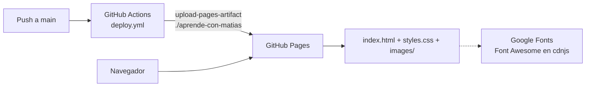

# Aprende con Matías

Sitio web estático de una página (HTML + CSS, sin JavaScript) que presenta una academia de dibujo ficticia, publicado en GitHub Pages.

## Descripción

Es una maqueta de página de aterrizaje para cursos de dibujo. Según el historial de commits, el contenido de los cursos es
ficticio. Sirve como ejemplo de una landing page con estética «glassmorphism», degradados y una galería con efecto al
pasar el cursor. No tiene backend, formularios ni recolección de datos.

## Funciones

- Barra de navegación con anclas internas a cada sección.
- Secciones: portada (`#hero`), «Sobre mí» (`#sobre-mi`), galería, portafolio (`#portafolio`), cursos (`#cursos`) y
  testimonios (`#testimonios`), más pie de página.
- Galería y sección «Sobre mí» con dos versiones de cada imagen: al pasar el cursor se muestra la versión ilustrada
  encima de la fotografía (`.img-real` / `.img-animated` en `styles.css`).
- Tarjetas de cursos y de portafolio con animaciones de hover.
- Diseño adaptable: un único punto de quiebre en `@media (max-width: 768px)`.
- Tema oscuro definido con variables CSS en `:root` (`--bg-dark`, `--primary`, `--secondary`, `--accent`, etc.).
- Recursos externos: Google Fonts y Font Awesome 6 desde cdnjs.

## Arquitectura



## Requisitos

- Un navegador moderno.
- Opcional, para servir en local: Python 3 (o cualquier servidor estático).

## Instalación e inicio rápido

```bash
git clone https://github.com/Lapeyus/matias.git
cd matias/aprende-con-matias
python3 -m http.server 8000
# abrir http://localhost:8000
```

También funciona abriendo `aprende-con-matias/index.html` directamente en el navegador.

## Uso

No hay paso de compilación: se editan `index.html` y `styles.css` y se recarga el navegador. Las imágenes se referencian
con rutas relativas a `images/`.

## Estructura del repositorio

```text
matias/
├── .github/workflows/deploy.yml   # Publica ./aprende-con-matias en GitHub Pages en cada push a main
└── aprende-con-matias/
    ├── index.html                 # Página única (≈400 líneas), todo el contenido
    ├── styles.css                 # Estilos, variables de tema y media query móvil (≈700 líneas)
    └── images/                    # Imágenes PNG/JPG usadas por la página (≈34 MB en total)
```

## Configuración

No hay variables de entorno, secretos ni archivos locales. El único ajuste externo es activar GitHub Pages con origen
«GitHub Actions» en la configuración del repositorio.

## Pruebas

No hay pruebas automatizadas.

## Despliegue

`.github/workflows/deploy.yml` se ejecuta en cada push a `main` (o manualmente con `workflow_dispatch`): hace checkout,
sube la carpeta `aprende-con-matias` como artefacto de Pages y la publica con `actions/deploy-pages@v4`.

## Estado del proyecto

Experimento / maqueta. Seis commits, todos el 4 de enero de 2026; sin actividad posterior.

## Limitaciones conocidas

- La navegación incluye un enlace a `#contacto`, pero la página no tiene una sección con ese `id`; varios enlaces usan
  `href="#"` como marcador de posición.
- Las imágenes no están optimizadas (el repositorio pesa ≈34 MB por ellas).
- No hay archivo LICENSE: el contenido no tiene una licencia de uso declarada.
